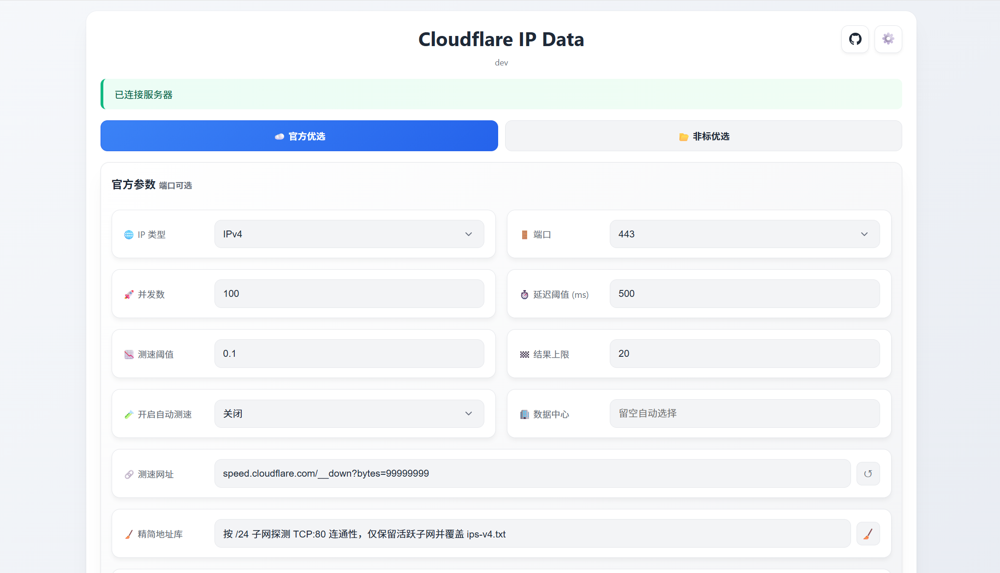

# CFData-Web

CFData-Web 是一个基于 Go 的 Cloudflare IP 测试与筛选工具，提供本地 Web 与 CLI 两种使用方式，支持官方 IP 段扫描、非标目标测试、测速、结果筛选、导出和 GitHub 上传。

[在线演示站](https://cfdata-demo.cce.de5.net/) 仅使用浏览器内虚拟数据，用于预览界面与交互；真实使用请下载正式版本。



### 更新说明

项目功能已趋于完善，基本达到了作者预期的效果。后续更新将以维护和新功能为主，版本迭代频率会有所降低。如果你在使用过程中有新的需求或建议，欢迎提交 Issue，作者会在评估后酌情纳入后续版本。

近期主要更新：

- 非标链路复验：扫描完成后对候选做真实 TCP+TLS+HTTP 探针验证（Web 支持手动复验按钮），不可用候选自动剔除
- 测速地址可用性预检：启动时并行探测全部内置与自定义测速地址，自动选择时排除不可用项，全部不可用回退 CF 官方地址；Web 下拉框实时展示可用性
- 结果区「筛选排序」合一：原独立筛选下拉与一键排序合并进单个弹窗，新增「延迟低于 xx ms」「丢包低于 xx%」筛选，并与复制/导出内容联动
- 管理面代理：新增 -proxy 参数与配置文件 proxy 键（支持 socks5://、socks5h://、http://、https://），覆盖数据下载、版本检查、GitHub/订阅上传；Web 设置菜单可直接配置，未配置时自动使用系统环境变量代理；扫描与测速保持直连
- CLI 交互菜单：`-cli` 进入菜单（按配置启动 / 自定义参数启动 / 修改配置参数 / 定时任务 / 帮助），`-cli qs` 按已保存配置快速启动，`-cli -参数…` 直接执行；启动时输出 Banner 与「调试等级」
- 参数设置向导：分模块逐项设置，提示格式与可选值，可保存为配置文件
- 定时任务：仅 Linux systemd，按天/周/月执行，开机自启，失败自动回滚清理，unit 与日志在程序目录
- 官方/非标的扫描并发、延迟阈值、测速网址在命令行与配置文件中完全独立，互不影响
- 配置文件自动迁移：键名无变化时静默按新模板迁移；存在旧键名时交互提示（仅迁移同名值），原文件备份为 `.bak`，非交互环境自动跳过
- 启动输出统一为简洁的「当前配置」单块，版本行下方显示调试等级

## 功能

- 官方优选：扫描 Cloudflare IPv4/IPv6，按数据中心继续详细延迟测试。
- 非标优选：上传本地 txt/csv 或填写网络 URL，测试自定义 IP/域名与端口。
- Trace 地区初筛：独立部署配置默认且强制使用 NiREvil/VLESS 公开地区名单；按 ISO 地区筛候选，默认每地区最多 10 条、总量最多 500 条，硬上限 100/2,000 条、并发最高 16。该名单只是粗筛，不等同于 FOFA 条件或 FOFA 命中。实际探测使用目标域名作为 SNI/Host，严格校验证书并请求 `/cdn-cgi/trace`；Cloudflare 官方网段仅下载作排除，绝不作为候选。支持后台进度、取消及 TXT/CSV 导出。
- Trace 手动检测：基础版支持最多 10 个公网 IP:端口；`cfdata-trace` 独立部署 profile 禁用该入口，只检测区域名单返回的候选。
- 测速：支持单点测速、批量测速、非标并发测速和测速阈值筛选。
- 链路复验：扫描完成后对候选做真实 TCP+TLS+HTTP 探针验证，自动剔除不可用项；Web 支持手动复验按钮。
- 导出：支持 CSV/TXT、自定义字段、IP 类型筛选、合格结果筛选。
- 上传：支持将导出结果上传到 GitHub。
- CLI：交互菜单、参数设置向导、定时任务、配置自动迁移。
- APK：支持 Android WebView 壳运行内置后端。

## 快速开始

从 [Releases](https://github.com/PoemMisty/CFData-WEB/releases/latest) 下载对应平台程序后运行。

默认启动 Web 模式：

```text
服务启动于 http://localhost:13335
当前测速网址: auto
```

浏览器打开终端中的地址即可使用。

公网部署时应启用 Web 账号密码，并只通过 HTTPS 反向代理对外提供访问。可使用 `-user`/`-password` 参数，也可在部署环境的密钥变量中设置 `CFDATA_WEB_USER` 与 `CFDATA_WEB_PASSWORD`；显式命令行参数优先。

`cfdata-trace` 部署 profile 只从 [NiREvil/vless 公开区域清单](https://raw.githubusercontent.com/NiREvil/vless/main/sub/ProxyIP-for-zizifn.json)取候选，服务端拒绝 FOFA 来源并不注册手动 IP 探测接口；不设置、不使用 FOFA Key，也不会连接候选，除非用户在页面主动启动任务。该上游扫描器使用固定 SNI/Host `cf-connecting.pages.dev` 并禁用证书校验，因此名单只是粗筛数据，不等于 FOFA 结果，也不保证任意目标域名兼容。实际探测使用目标域名和严格 TLS 校验，Cloudflare 官方网段只作排除。区域任务在进程存活期间运行，重启后内存结果不会保留。

CLI 模式（进入交互菜单）：

```bash
./cfdata-linux-amd64 -cli
```

菜单提供：按配置启动（菜单 1，等价 `-cli qs`）、自定义参数启动（向导）、修改配置参数、定时任务、帮助。

首次使用 CLI 配置文件时会生成模板并退出，编辑配置后重新运行即可；也可通过菜单「修改配置参数」逐项设置。升级后启动时若配置键名有变化会提示迁移：同名值保留，原文件备份为 `.bak`，非交互环境自动跳过。

简单示例：

```bash
# 交互菜单（不带其他参数时默认进入菜单）
./cfdata-linux-amd64 -cli

# 按已保存配置快速启动（qs 大小写不敏感）
./cfdata-linux-amd64 -cli qs

# 官方模式直接执行：扫描 IPv4，测试 443 端口，测速地址自动选择
./cfdata-linux-amd64 -cli -mode official -offiptype 4 -offport 443 -offurl auto

# 非标模式直接执行：读取本地文件，开启 TLS 和 5 个测速线程
./cfdata-linux-amd64 -cli -mode nsb -nsbfile ip.txt -nsbtls=true -nsbspeedtest 5 -nsburl auto
```

## Web 使用

界面顶部「扫描方式」选择器支持 TCPing（默认）和 HTTPing。不同扫描模式的延迟数据不可互相比较，仅同模式内的对比才有意义。

### 扫描方式说明

- **TCPing**：测量 TCP 握手延迟，基准值。
- **HTTPing**：测量 HTTP TTFB（Time To First Byte），延迟比 TCPing 高属正常现象。延迟阈值和渲染颜色已按倍率自动缩放，倍率仅为延迟等级参考值，非精确换算：
  - 无 TLS（HTTP 端口）：×1.3
  - 有 TLS（HTTPS 端口）：×4.0

### 官方优选

1. 选择 IPv4 或 IPv6。
2. 设置测试端口、扫描并发、延迟阈值。
3. 点击“开始扫描与测试”。
4. 扫描完成后选择数据中心继续详细测试。
5. 在详细测试结果中可单点测速或批量测速。

### 非标优选

1. 切换到“非标优选”。
2. 上传 txt/csv，或填写网络 URL（二选一）。
3. 设置备用端口、并发、TLS、结果上限、测速线程、测速阈值等参数。
4. 点击“开始扫描与测试”。
5. 在结果表格查看、筛选、导出或上传。

非标输入推荐格式：

```text
1.2.3.4 443
5.6.7.8 8443
2606:4700::1111 443
1.1.1.1
```

未提供端口时会使用备用端口；备用端口默认随 TLS 模式自动选择，关闭 TLS 为 80，开启 TLS 为 443。

### Trace 检测

`cfdata-trace` 独立 profile 登录后直接进入区域 Trace 页面。选择 1–249 个 ISO 地区，服务只从公开区域名单取这些地区的 IP:端口候选，并按限制执行严格 TLS 的 `/cdn-cgi/trace` 检测；支持后台进度、取消、TXT/CSV 导出。该部署不提供 FOFA 查询或手动 IP 输入，Cloudflare 官方 IP 网段只作候选排除；源名单地区与 Trace `loc`/`colo` 分开显示。名单上游覆盖范围会变化；已核实的 2026-11-13 快照覆盖 69 个地区，不能据此声称等同 FOFA 或全球完整覆盖。

`loc` 是 Cloudflare trace 报告的请求来源地区，`colo` 是处理请求的 Cloudflare 机房代码；两者都不保证是候选 IP 的物理位置。普通 TLS SNI 未启用 ECH，域名可能在 TLS 握手中以明文出现。Trace 页面与 API 复用 CFData-WEB 的现有 Web 登录会话。

## 测速地址

默认测速地址为 `auto`，表示由后端自动选择内置测速源。

启动时会对全部内置测速地址和已输入的自定义测速地址做可用性测试（小体积探测），自动选择时跳过不可用地址；若全部不可用则回退 CF 官方地址。Web 端会把测试结果同步到测速地址下拉框，不可用项会标注「不可用」。

Web 下拉项：

- 自动选择
- Cloudflare
- CM提供
- 移动专属
- 手动输入

CLI 可通过 `-offurl`/`-nsburl` 指定：

```bash
./cfdata-linux-amd64 -cli -offurl auto
./cfdata-linux-amd64 -cli -offurl speed.cloudflare.com/__down?bytes=99999999
./cfdata-linux-amd64 -cli -offurl https://example.com/file.bin
```

说明：测速只读取响应字节流计算速度，不会把测速文件保存到本地。

## 常用参数

```text
-cli              启用 CLI 模式
-mode             official 或 nsb
-scanmode         扫描方式：tcping（默认，TCP 握手延迟）或 httping（HTTP TTFB，延迟比 tcping 高属正常，不同模式数据不可对比）
-offthreads       官方扫描并发数
-nsbthreads       非标扫描并发数
-offport          官方测试/测速端口
-offdelay         官方延迟阈值，单位毫秒
-nsbdelay         非标延迟阈值，单位毫秒；0=不筛延迟
-offurl           官方测速下载地址，默认 auto
-nsburl           非标测速下载地址，默认 auto
-dns              自定义 DNS 服务器
-debug            调试日志等级：false、error、all
-skipgeo          跳过地区/代理环境验证（启动时不再提示代理警告）
-out              输出文件名（官方/非标通用），默认 cfdata-results
```

非标常用参数：

```text
-nsbfile          本地输入文件
-nsbsourceurl     网络输入 URL
-nsbfallbackport  非标输入缺省端口；不传时随 TLS 自动使用 443/80
-nsbtls           非标是否启用 TLS
-nsbspeedtest     非标测速线程数，0 表示不测速。多 IP 并发影响实际速度，需要准确应设为 1
-nsbresultlimit   非标延迟测试结果上限
-nsbspeedmin      非标测速合格阈值，单位 MB/s
-nsbspeedlimit    非标测速合格结果上限
-relink           链路复验开关（默认开启）；扫描完成时对结果做真实链路验证，不可用的候选将被剔除
-relinkhost       链路复验探针域名；默认使用内置公共探针，配合 -relink 开关使用
-proxy            管理面代理地址（支持 socks5://、socks5h://、http://、https://）；下载 ASN 库/locations、版本检查、GitHub/订阅上传走此代理，扫描测速不受影响；留空走系统环境变量代理
```

完整参数可运行：

```bash
./cfdata-linux-amd64 -h
```

## 本地缓存

Web 右上角设置菜单提供“恢复全部默认配置”，会清理本地缓存文件，例如 `ips-v4.txt`、`ips-v6.txt`、`locations.json`、ASN 数据库等。任务运行中不会直接清理，避免影响测试。

## 免责声明

本程序仅限用于学习与研究目的。请在下载后24小时内自行删除。使用本程序时，应自行遵守所在地区的法律法规。作者不对使用本程序所产生的任何后果承担责任。下载或使用本程序即视为已阅读、理解并同意上述声明。

## 致谢

- TG 频道：[CF中转IP](https://t.me/CF_NAT)
- GitHub：[Kwisma/iptest](https://github.com/Kwisma/iptest)

## License

Copyright (C) 2026 PoemMisty

This project is licensed under the GNU General Public License v3.0 or later.
See the LICENSE file for details.
